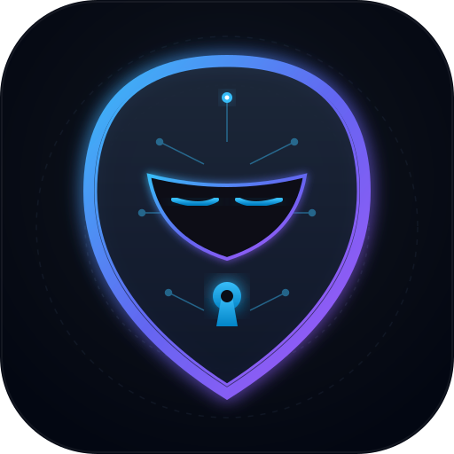

<p align="center">
  
</p>

<h1 align="center">🛡️ Shadow Agent</h1>

<p align="center">
  <strong>Local Privacy Guard & High-Performance Masking Proxy for LLMs</strong><br>
  <em>Zero Data-Leakage • Sub-Millisecond AST Masking • Air-Gapped Fallback • GDPR/HIPAA Ready</em>
</p>

<p align="center">
  <a href="#-caratteristiche-principali">Caratteristiche</a> •
  <a href="#-avvio-rapido">Avvio Rapido</a> •
  <a href="#-monitor-live-da-terminale-tui">Live Monitor</a> •
  <a href="#-docker--air-gapped-stack">Docker Stack</a> •
  <a href="#-contact-support--commercial-inquiries">Contatti</a>
</p>

---

## ⚡ Caratteristiche Principali

- **Drop-in OpenAI Compatible**: Usa lo standard `/v1/chat/completions` — funziona immediatamente con Cursor, Continue, LangChain, LlamaIndex o qualsiasi SDK.
- **Sub-millisecond Masking**: Riconoscimento ed espunzione istantanea di:
  - Chiavi API (OpenAI, AWS, generiche)
  - Token JWT
  - Indirizzi email
  - Indirizzi IPv4
  - Carte di credito
  - Codici IBAN
- **Code & Database Guard**: Riconosce e maschera URI di connessione a database (`postgres://`, `mysql://`, `mongodb://`, `redis://`), password SQL hardcoded e nomi di tabelle/schemi sensibili proprietari (`*_prod`, `*_secrets`, `*_billing`, `*_finance`).
- **Synthetic Replacement**: Invece di `[TOKEN_1]`, sostituisce i dati con valori realistici e coerenti (`user_1@example-sandbox.org`, `10.0.0.1`), mantenendo naturale il contesto per il modello.
- **Local Semantic LRU Cache**: Memorizza in-memory le risposte dei prompt sanitizzati con hashing SHA-256 e TTL. Elimina chiamate cloud duplicate, tagliando a zero la latenza e i costi per prompt ricorrenti.
- **Streaming De-anonymization Resiliente**: Buffer a finestra scorrevole che ricostruisce i dati originali in tempo reale via Server-Sent Events (SSE) anche se i token vengono spezzati su chunk HTTP differenti.
- **Intelligent Air-Gap Routing**: Se il prompt contiene parole chiave critiche o una densità eccessiva di dati riservati, la richiesta viene reindirizzata automaticamente su un motore locale (Ollama / vLLM / llama.cpp).
- **Audit Log Locale Immutabile**: Traccia le metriche di mascheramento e l'hash SHA-256 della richiesta su file `.jsonl` locale senza mai registrare i dati sensibili in chiaro.

---

## 🚀 Avvio Rapido

### 1. Installazione
Richiede Python 3.12+ e [uv](https://github.com/astral-sh/uv):

```bash
uv sync
```

### 2. Prova il motore di mascheramento da CLI
```bash
uv run shadow-agent test-mask "Ho un token sk-proj-1234567890abcdef1234567890abcdef per dev@company.com su 192.168.1.50"
```

### 3. Avvia il Proxy Locale
```bash
uv run shadow-agent start --port 8080
```

Il proxy sarà attivo su: `http://127.0.0.1:8080/v1`

### 4. Monitor Live da Terminale (TUI)
In una nuova finestra di terminale, visualizza in tempo reale le transazioni, i segreti intercettati e le metriche di latenza:
```bash
uv run shadow-agent monitor
```

### 5. Genera Report di Audit & Compliance (GDPR / HIPAA / SOC2)
Genera un report esecutivo HTML con statistiche complete sulle entità mascherate, latenze e certificazioni di conformità:
```bash
uv run shadow-agent report --output report.html
```

---

## 🐳 Docker & Air-Gapped Stack

Puoi avviare l'intero stack isolato (Shadow Agent + Ollama locale integrato) tramite Docker Compose:

```bash
docker compose up -d
```
Il proxy risponderà su `http://localhost:8080/v1` e Ollama su `http://localhost:11434/v1`.

---

## 🔌 Utilizzo con Client & IDE

### Con Python OpenAI SDK
```python
from openai import OpenAI

client = OpenAI(
    base_url="http://127.0.0.1:8080/v1",
    api_key="sk-shadow-local"
)

response = client.chat.completions.create(
    model="shadow-auto",  # oppure gpt-4o-mini, qwen2.5-coder:7b
    messages=[
        {"role": "user", "content": "Verifica se la configurazione su 192.168.1.100 e sicura per dev@azienda.it"}
    ]
)

print(response.choices[0].message.content)
```

---

## ⚙️ Configurazione (`shadow_agent.yaml`)

```yaml
host: "127.0.0.1"
port: 8080
upstream:
  cloud_url: "https://api.openai.com/v1"
  cloud_default_model: "gpt-4o-mini"
  local_url: "http://localhost:11434/v1"
  local_default_model: "qwen2.5-coder:7b"
privacy:
  synthetic_replacement: true
  force_local_keywords:
    - "proprietary algorithm"
    - "patient record"
```

---

## 📬 Contact, Support & Commercial Inquiries

If you have questions, feedback, enterprise integration requests, or custom agent governance needs, feel free to reach out directly:

- **Lead Developer & Maintainer:** Franca Roscilli
- **Email:** [francaroscillidev@gmail.com](mailto:francaroscillidev@gmail.com)
- **GitHub:** [@francaroscillidev-gif](https://github.com/francaroscillidev-gif)
- **Bug Reports & Feature Requests:** [Open an issue on GitHub](https://github.com/francaroscillidev-gif/shadow-agent/issues)


